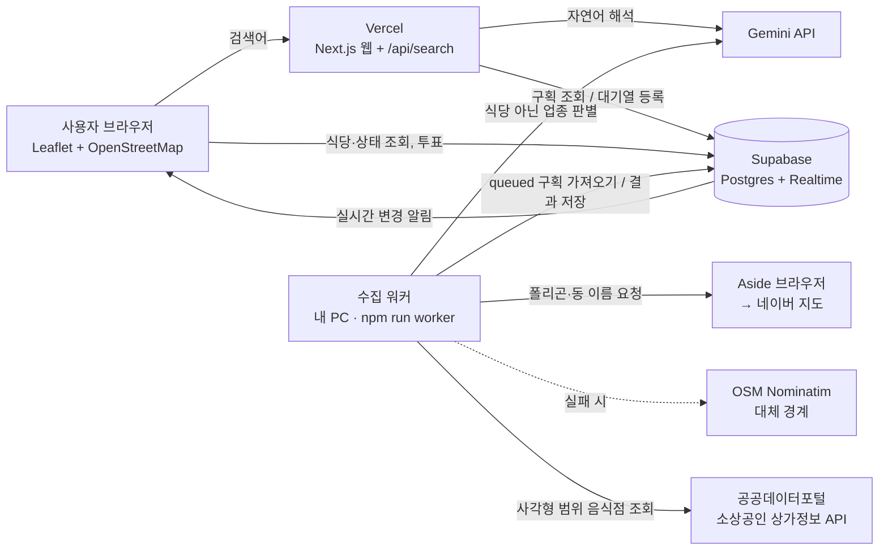
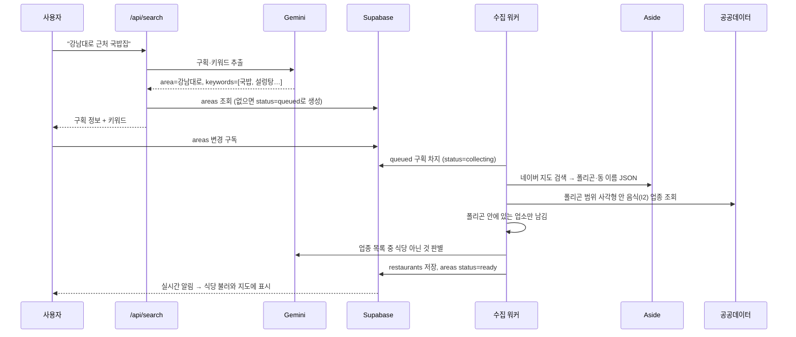
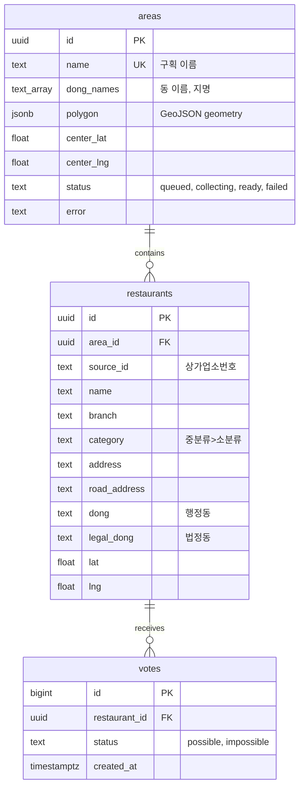

# Architecture

## 전체 구성



| 구성 요소 | 위치 | 역할 |
| --- | --- | --- |
| 웹 화면 | Vercel (브라우저에서 실행) | 검색창, 지도, 마커, 투표 버튼, 실시간 구독 |
| 검색 API | Vercel 서버 | 입력 해석(Gemini), 구획 조회, 없으면 수집 대기열 등록 |
| Supabase | 클라우드 | 데이터 저장, 수집 대기열, 실시간 갱신 |
| 수집 워커 | 내 PC | Aside·공공데이터·Gemini를 써서 구획과 식당 수집 |
| Aside | 내 PC | 네이버 지도에서 구획 폴리곤과 동 이름·지명 추출 |

수집 워커가 내 PC에 있는 이유: Aside는 내 PC에 설치된 브라우저라 Vercel 서버에서 실행할 수 없기 때문입니다.
Supabase의 `areas.status`를 대기열로 써서 웹과 워커를 연결합니다.

## 처리 흐름

### 검색과 수집



- "을지로", "연남동"처럼 `로/길/동/가`로 끝나는 짧은 입력은 Gemini를 거치지 않고 바로 구획 이름으로 씁니다.
- 이미 `ready`인 구획은 수집 없이 바로 표시됩니다. `failed`인 구획은 다시 검색하면 재수집합니다.
- 워커를 다시 켜면 `collecting`에 멈춰 있던 구획을 `queued`로 되돌립니다.

### 구획 폴리곤 결정 순서

1. Aside REPL로 네이버 지도에서 입력한 이름을 검색 → 지도가 불러온 `/p/api/polygon`(행정동 경계 GeoJSON)과
   `/p/api/entry/addressInfo`(구·동 이름, 행정동 코드)를 같은 페이지 안에서 읽음 (`worker/naver.mjs`)
2. 경계가 없으면(도로명 등) 이름 뒤에 "동"을 붙여 다시 검색 — 예: `을지로` → `을지로동`
3. 그래도 없으면 OpenStreetMap Nominatim 경계
4. 도로처럼 선(LineString)으로만 나오면 선을 감싸는 약 80m 여유의 사각형

네이버 내부 검색 API를 직접 호출하면 캡차가 걸리므로, 항상 화면에서 검색한 뒤 지도가 스스로 불러온 응답만 읽습니다.

### 비플페이 투표

1. 마커 클릭 → 팝업의 [비플페이 가능] / [불가능]
2. 화면을 먼저 바꾸고 `votes`에 한 줄 추가 (로그인 없이 anon 키로 저장)
3. Supabase Realtime이 다른 사용자 화면에 즉시 전달
4. 상태는 `restaurant_status` 뷰가 식당별 **가장 최근 응답**으로 결정

| 상태 | 마커 |
| --- | --- |
| 가능 | 검은 점 + 형광 녹색 테두리 깜빡임 (`neon-blink` 애니메이션) |
| 불가능 | 회색 |
| 응답 없음 | 파란색 |

## 데이터 모델



- `restaurant_status` 뷰: `votes`에서 식당별 최신 1건 (`distinct on … order by created_at desc`)
- 투표를 덮어쓰지 않고 기록으로 쌓기 때문에 언제 누가(익명) 바꿨는지 이력이 남습니다.

### 권한 (RLS)

| 테이블 | 누구나 (anon) | 서버 (service role) |
| --- | --- | --- |
| areas | 읽기 | 생성·수정 (검색 API, 워커) |
| restaurants | 읽기 | 저장 (워커) |
| votes | 읽기, 추가 | — |

Realtime 대상: `areas`(수집 상태), `votes`(투표).

## 폴더 구조

```
261103/
├─ app/
│  ├─ layout.jsx            HTML 뼈대, Leaflet CSS
│  ├─ page.jsx              메인 화면: 검색, 상태 표시, 실시간 구독, 투표, 키워드 필터
│  ├─ globals.css           레이아웃, 마커 스타일, 형광 깜빡임 애니메이션
│  └─ api/search/route.js   검색 API (Gemini 해석 → 구획 조회/등록)
├─ components/
│  └─ MapView.jsx           Leaflet 지도: OSM 타일, 폴리곤, 마커, 팝업
├─ lib/
│  ├─ supabaseBrowser.js    브라우저용 Supabase 클라이언트 (anon 키)
│  ├─ supabaseAdmin.js      서버용 Supabase 클라이언트 (service role 키)
│  └─ gemini.js             자연어 검색 해석, 식당 아닌 업종 판별
├─ worker/
│  ├─ collect.mjs           수집 워커 (Aside → 공공데이터 → Gemini → Supabase)
│  ├─ naver.mjs             Aside REPL로 네이버 지도 경계·주소 정보 읽기
│  └─ geo.mjs               폴리곤 안 판별, 범위 계산, 선 → 사각형
├─ supabase/
│  └─ schema.sql            테이블, 뷰, RLS, Realtime 설정
├─ .env.example             환경변수 목록
├─ README.md                설치·실행 방법
├─ 작업절차.md              작업 과정 기록
└─ architecture.md          이 문서
```

## 환경변수

| 이름 | 사용처 | 설명 |
| --- | --- | --- |
| `NEXT_PUBLIC_SUPABASE_URL` | 웹, 워커 | Supabase 프로젝트 URL |
| `NEXT_PUBLIC_SUPABASE_ANON_KEY` | 웹 | 브라우저용 공개 키 |
| `SUPABASE_SERVICE_ROLE_KEY` | 검색 API, 워커 | 서버 전용 키 (브라우저 노출 금지) |
| `GEMINI_API_KEY` | 검색 API, 워커 | Gemini 키 |
| `GEMINI_MODEL` | 검색 API, 워커 | 기본 `gemini-flash-lite-latest` (혼잡·한도 초과 시 재시도 후 `gemini-flash-latest`로 전환) |
| `DATA_GO_KR_SERVICE_KEY` | 워커 | 공공데이터포털 인증키 (Decoding) |
| `ASIDE_CLI` | 워커 | Aside CLI 실행 파일 경로 (기본 `aside`) |
| `ASIDE_CLI_AUTH_PATH` | 워커 | Aside CLI 로그인 정보 파일 경로 |

## 기술 스택

| 영역 | 기술 |
| --- | --- |
| 프레임워크 | Next.js 15 (App Router), React 19 |
| 지도 | Leaflet 1.9, react-leaflet 5, OpenStreetMap 타일 |
| DB / 실시간 | Supabase (Postgres, Realtime), supabase-js 2 |
| AI | Gemini (`@google/genai`) |
| 수집 | Aside CLI, 공공데이터포털 상가정보 API, Nominatim |
| 배포 | Vercel (웹), 내 PC (워커) |

## 제약과 주의점

- **새 구획 수집은 내 PC가 켜져 있고 워커가 실행 중일 때만** 진행됩니다. 이미 수집된 구획은 상관없습니다.
- 네이버 지도 화면 구조나 내부 응답 형식이 바뀌면 `worker/naver.mjs`를 고쳐야 합니다. Aside 원본 출력은 `worker/last-aside-output.txt`에 남습니다.
- 네이버 지도 데이터를 자동으로 가져오는 것은 네이버 이용약관 검토가 필요할 수 있습니다.
- 로그인이 없어서 누구나 투표할 수 있습니다. 악용이 생기면 요청 제한(rate limit)이나 간단한 인증을 추가해야 합니다.
- OpenStreetMap 공개 타일·Nominatim은 사용량 제한이 있어서, 사용자가 많아지면 별도 타일 서버가 필요합니다.
